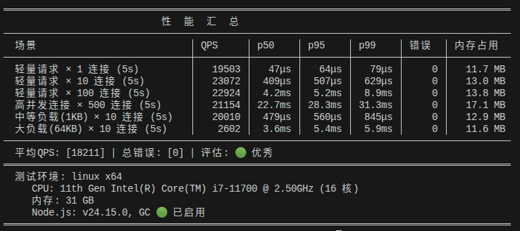

<!-- START doctoc generated TOC please keep comment here to allow auto update -->
<!-- DON'T EDIT THIS SECTION, INSTEAD RE-RUN doctoc TO UPDATE -->
<!-- DON'T EDIT THIS SECTION, INSTEAD RE-RUN doctoc TO UPDATE -->

- [快速开始](#快速开始)
- [简述](#简述)
  - [这是什么](#这是什么)
  - [为什么要做](#为什么要做)
  - [特性](#特性)
    - [await request(...)](#await-request)
    - [自定义JSON序列化](#自定义json序列化)
    - [JSON-RPC 2.0](#json-rpc-20)
    - [其它](#其它)
  - [Typescript支持](#typescript支持)
    - [Server](#server)
    - [Client](#client)
- [Server](#server-1)
  - [register](#register)
  - [中间件-use](#中间件-use)
  - [发送通知-sendout](#发送通知-sendout)
  - [监听通知-onNotice](#监听通知-onnotice)
  - [socket](#socket)
  - [socket属性](#socket属性)
    - [属性的设置](#属性的设置)
    - [属性的获取](#属性的获取)
  - [socket连接](#socket连接)
    - [获取连接](#获取连接)
    - [获取连接属性](#获取连接属性)
    - [设置连接属性](#设置连接属性)
    - [online](#online)
    - [offline](#offline)
  - [错误处理](#错误处理)
- [Client](#client-1)
  - [request](#request)
  - [批量请求-batch](#批量请求-batch)
  - [发送通知-notify](#发送通知-notify)
  - [监听通知-listening](#监听通知-listening)
  - [连接状态](#连接状态)
    - [关闭连接](#关闭连接)
    - [离线处理](#离线处理)
- [其它](#其它-1)
  - [关于id](#关于id)
  - [JsonRPCIdGenerator](#jsonrpcidgenerator)
  - [ping](#ping)
  - [多实例相关](#多实例相关)
  - [Server性能](#server性能)
  - [暂无其它](#暂无其它)

<!-- END doctoc generated TOC please keep comment here to allow auto update -->

# 快速开始

```shell
npm install @coco-sheng/websocket-rpc
```

Server：

```typescript
import { WebSocketServer } from '@coco-sheng/websocket-rpc';

const server = new WebSocketServer({ port: 3403 });

server.register('hello', () => {
    return 'hello world!';
});

server.start();
```

Client(支持浏览器端)：

```typescript
import { WebSocketClient } from '@coco-sheng/websocket-rpc';
// 浏览器端使用如下方式引入，使用方式一致
// import { BrowserWsClient } from '@coco-sheng/websocket-rpc/browser';

const client = new WebSocketClient('ws://localhost:3403');

await client.open();

const result = await client.request('hello');

console.log(result);
// 'hello world!'
```

# 简述
## 这是什么

这是一个基于[ws](https://www.npmjs.com/package/ws)，遵循标准[JSON-RPC 2.0](https://wiki.geekdream.com/Specification/json-rpc_2.0.html)协议的websocket应用框架，灵感来源于实际项目中使用websocket实现rpc的需求，可用性经过了实际项目的检测，性能表现优异。该项目专注RPC设计，旨在做纯粹的websocket RPC，极致轻量，无任何业务逻辑入侵。

## 为什么要做

在传统的websocket使用中，Server端我们可能会这么做：

```typescript
// ...

const websocketServer = ...;

websocketServer.on('connection',socket => {
    socket.on('message',data => {
        if(data.xxx === 'xxx'){ // 业务标识判断
            // 具体业务逻辑
        }
        // ...
    });

    socket.on(...)

    // ...
});

// ...
```

这种做法，出现了nodejs开发中极力避免的层层嵌套问题，同时需要对服务器接收到的数据做大量的业务标识判断，开发者需要分出一部分精力来把业务数据分流到对应的业务处理逻辑中，同时对websocket各个时间节点(上线、下线、登录、session等)进行小心维护。

而在Client我们可能会这么做：

```typescript
// ...

const client = ...;

client.on('open',() => {
    // ...
};

client.on('message', data => {
    // ...

    if(data.xxx === 'xxx'){
        // 具体业务逻辑
    }

    // ...
});


client.emit('xxx', () => {
    // ...
});


client.on('xxx', () => {
    // ...
});

// ...
```

出现回调嵌套问题的同时，客户端会出现大量对请求响应数据的监听，影响性能和交互体验，也出现了大量的代码冗余，非常不方便开发。

我们希望的服务器端没有太多针对请求的甄别判断来区分具体处理的业务，直接可以将精力聚焦到对业务的处理上。同时，我们对客户端不用对业务请求的结果做甄别，不用担心接收到的数据不是该业务的结果，也不用写大量的冗余监听。这就是`@coco-sheng/websocket-rpc`想要做的，除此之外，我还针对服务器端上线、下线、基本错误、Server日志、通知等情况做了处理，同时给出Server多实例部署的解决方案。当然你也可以从Server/Client对象上方便的获取到连接实例，根据自己的业务需求发送其它非[JSON-RPC 2.0](https://wiki.geekdream.com/Specification/json-rpc_2.0.html)规范的数据，我保留了用户对原始对象的访问。

`@coco-sheng/websocket-rpc`经过了实际项目的检测，性能表现优异，多实例部署也经住了考验(多实例部署方案见[多实例相关](#%E5%A4%9A%E5%AE%9E%E4%BE%8B%E7%9B%B8%E5%85%B3)部分)。


## 特性
### await request(...)
&emsp;&emsp;传统websocket发送请求到服务器，希望收到响应，往往需要监听`message`事件，而`message`事件监听获得的消息是websocket发送的所有请求的响应，没有请求-响应的对应关系，因此需要开发者自己维护一个请求-响应的对应关系，而`@coco-sheng/websocket-rpc`通过`request`方法，将请求和响应的对应关系维护在内部，开发者只需要关注业务逻辑即可，无需关注请求-响应的对应关系。`request`方法返回的`Promise`对象，是真正意义上的收到响应即获得，其请求-响应的对应关系没有借用诸如`setTimeout/setInterval`来实现，可放心使用。

### 自定义JSON序列化
&emsp;&emsp;JavaScript的`JSON`对象在序列化`Date`时变成了`ISO`字符串，`BigInt`直接报错，`Uint8Array / Buffer`变成了普通对象，业务层必须在发送数据前后手动转译数据。`@coco-sheng/websocket-rpc`在Server和Client均设置了扩展配置项，允许用户自定义指定Json数据序列化和反序列化工具，解决了JavaScript的`JSON`对象数据类型丢失的问题。

### JSON-RPC 2.0
&emsp;&emsp;`@coco-sheng/websocket-rpc`严格遵循[JSON-RPC 2.0](https://wiki.geekdream.com/Specification/json-rpc_2.0.html)规范，在Client，用户使用`request`等发送请求，不必关注数据是否符合规范，只需按照业务需求发送数据即可，`@coco-sheng/websocket-rpc`会自动将数据封装成符合规范的数据格式。在Server，用户注册的method，用户同样只需关注业务逻辑，无需关注数据格式，这一切都自动处理好了，即使你使用其他语言或框架发送消息，消息格式只要符合`JSON-RPC 2.0`规范，`@coco-sheng/websocket-rpc`的Server就可以正确接受和解析。当然，如果你想发送非`JSON-RPC 2.0`规范的数据，也可以在Server/Client对象上方便的获取到连接实例，发送自定义的数据。

### 其它
- 日志
  - Server扩展配置项里，用户可开启日志打印，或自定义制定日志工具，日志打印将显示出服务器收到/发送的数据，详细配置请查看对应的配置项说明。
- 监听/发送通知
  - Server端封装了`onNotice`和`sendout`方法，可方便的监听Client推送的通知，以及向Client发送通知。
  - Client提供了`listening`和`notify`方法，供Client来监听Server推送的通知，以及向Server发送通知。
- 批量请求
  - Client除了`request`发送单个请求外，还封装了`batch`方法，用户可批量发送请求，同时获取多个请求的响应。
- 请求超时
  - Client发送请求，允许用户在单个请求上设置超时时间，也可以在创建Client时在`WebSocketClient`的扩展配置上指定全局的统一的超时时间(适用于所有请求)，如果同时指定，则以每个请求上设置超时时间为准，如果都没有设置，则**默认全局超时10秒**，如果不希望设置超时，则可指定为0(全局设置/单个请求设置均支持)。

## Typescript支持
`@coco-sheng/websocket-rpc`提供了对typescript的支持，用户可通过泛型传递主要业务标识的定义，如`method`、通知消息的类型、通知消息监听的类型等。

> [!NOTE]
> &emsp;&emsp;我在设计typescript支持时，权衡了其在使用中的便利性和ts定义的灵活性，太全面的ts支持会使得用户在开发主要业务功能前就需要做大量的函数参数类型定义，这无疑会增加开发成本以及用户使用的心理负担，很多业务只有在功能设计完成后实际开发时才能确定其handler的参数都有什么，因此，`@coco-sheng/websocket-rpc`在ts支持上，舍弃了这种保姆式的类型定义支持，已经支持的ts定义，是我经过实际项目开发总结出来的开发者需要的定义，同时，允许用户不传递所有泛型也可以使用，当然，我也没有使handler的参数成为"anyscript"，根据实际项目的经验，大量的参数已经使用`unknown`进行了收窄，也给用户留出了需要"保姆式"定义的空间。

### Server
`new WebSocketServer()`的使用，提供了`Attr`、`Method`、`OnNoticeMethod`、`SendMethod`四个泛型：
- `Attr`：typescript定义[socket连接上的属性](#socket%E5%B1%9E%E6%80%A7)。
- `Method`：typescript定义Server注册的method，即[register](#request)注册的method。
- `OnNoticeMethod`：typescript定义Server注册的消息监听事件，即onNotice监听的notice。
- `SendMethod`：typescript定义Server发送通知的method，即sendout发送的method。

### Client
`new WebSocketClient()`的使用，提供了`Method`、`Notice`、`ListeningMethod`三个泛型：
- `Method`：typescript定义发送请求时的method值，即request请求的method。
- `Notice`：typescript定义Client发送通知时的notice值，即notify发送的notice。
- `ListeningMethod`：typescript定义Client注册的消息监听事件，即listening监听的method。


# Server

- `new WebSocketServer(configs, options?)`：创建一个`WebSocketServer`实例。
  - `configs`：服务器配置，详见[ws](https://www.npmjs.com/package/ws)的`WebSocketServer`中`ServerOptions`。
  - `options`：扩展配置。
    - `[options.log]`：`Boolean | Function`，默认`false`关闭日志打印，当为`true`时，将采用内置的`pino`日志配置打印日志，在使用内置`pino`打印日志时，如果读取到`process.env.NODE_ENV`为`development`时，日志将会显示打印位置，并做简单美化；如果为一个函数，则需要返回一个`Logger`对象，系统的日志将采用该对象打印。
    - `[options.jsonSerializer]`：自定义指定的`JSON`序列化函数，默认使用`JSON.stringify/JSON.parse`，并针对`Error`对象对`JSON.stringify`做了优化，使`Error`对象的详细信息(`name`/`stack`/`cause`/`message`)也能在JSON中显示出来，如果读取到`process.env.NODE_ENV`为`development`时，对`JSON.stringify`做了格式美化。

|方法|说明|
|------|------|
|`start()`|启动服务器|
|`register(...args)`|注册方法，详见[方法](#method)<br>`register(method, cb)`注册一个方法<br>`register(methods)`以对象形式，注册一个或多个method|
|`use(...args)`|注册中间件，详见[中间件](#中间件)<br>`use(...middlewares)`注册适用于所有method的一个或多个中间件<br>`use(method, ...middlewares)`注册只适用于某个method的一个或多个中间件|
|`onNotice(...args)`|注册notice消息的监听事件<br>`onNotice(...noticeHandlers)`注册一个或多个针对所有notice消息的监听事件<br>`onNotice(notice, ...noticeHandlers)`注册一个或多个只适用于某个notice消息的监听事件|
|`getSocket(connectId)`|根据socket的连接id获取socket对象|
|`getSockets(is)`|根据socket连接的属性数据获取socket对象<br>`is`为一个属性筛选函数|
|`getSocketAttr(...args)`|获取某个socket连接的属性<br>`getSocketAttr(connectId)`获取某个socket连接的全部属性<br>`getSocketAttr(connectId, attribute)`获取某个socket连接的某个属性，直接返回该属性的值<br>`getSocketAttr(connectId, ...attributes)`获取某个socket连接的某些属性，以对象的形式返回这些属性及其值|
|`getSocketsAttr(...args)`|获取某些socket连接的属性<br>`getSocketsAttr(is)`获取某些socket连接的全部属性<br>`getSocketsAttr(is, attribute)`获取某些socket连接的某个属性，直接以数组形式返回这些socket连接该属性的值<br>`getSocketsAttr(is, ...attributes)`获取某些socket连接的某些属性，以对象数组的形式返回这些属性及其值|
|`setSocketAttr(connectId, attribute)`|设置socket连接的属性<br>`attribute`为对象|
|`online(...args)`|设置客户端连接构建成功后的回调函数|
|`offline(...args)`|设置客户端连接断开后的回调函数|
|`error(...args)`|设置middleware或method运行出错时的错误处理函数|
|`close()`|关闭当前服务器实例|
|`clients`|当前服务器实例中所有socket连接|
|`methodList`|当前服务器实例中所有定义的method名称|
|`port`|当前服务器实例监听的端口|

## register

定义method(类似于定义一个api)：

```typescript
server.register('hello', () => {
    return 'hello world!';
});
```

你也可以同时定义多个method

```typescript
server.register({
    hello1() {
        return 'hello world1!';
    },
    hello2() {
        return {
            result: 'hello world2!'
        };
    },
    hello3(){
        console.log('hello world3!');
    }
});


// 使用变量定义
import { MethodFn } from '@coco-sheng/websocket-rpc';

const testMethod1: MethodFn<SocketAttr> = () => {
    console.log('test1');
};
const testMethod2: MethodFn<SocketAttr> = () => {
    console.log('test2');
};


server.register({ testMethod1, testMethod2 });
```

Client的请求：

```typescript
const result1 = await client.request('hello1');

console.log(result1);
// 'hello world1!'
```

***框架内置了两个method***：`connect`、`ping`。

```typescript
const result1 = await client.isConnected();

console.log(result1);
// { msg: 'connected', session: 'xxxxxxxxxx' }

const result2 = await client.ping();

console.log(result2);
// 'pong'
```

> [!NOTE]
> - 要中断method函数的执行，可以直接`return`，或者`throw`(你可以throw任何数据，比如数组、Object、Error对象等)，throw抛出的数据会被系统捕获，并封装为一个符合`JSONRPC-2.0`规范的错误数据返回，你也可以定义全局的[错误捕获回调函数](#servererror)，来自行处理`throw`抛出的数据。
> - 内置的method不支持注册中间件，若注册则被忽略。

## 中间件-use

中间件是一个在请求到达method之前对请求的数据和业务进行处理的函数。该函数如果返回一个Object，则会将该Object的属性挂载到当前socket连接的属性(后续业务可获取)上；返回其它数据结构则不做任何处理，后续业务逻辑也无法获取该返回值。可以定义针对全部method的一个或多个中间件，也可以为某个method定义一个或多个中间件，中间件的执行顺序为中间件定义的代码逻辑顺序。

定义全局的中间件：

```typescript
import { MiddlewareFn } from '@coco-sheng/websocket-rpc';

server.use(()=>{
    console.log('this is a middleware for all methods');
});

const mdw1: MiddlewareFn<SocketAttr> = (_params, socket, method) => {

    if (method !== 'login' && !socket.getAttr('userId')) {
        throw Error('you must login to do this!');
    }

    console.log('middleware 1 for all methods');
};
const mdw2: MiddlewareFn<SocketAttr> = () =>{
    // ...
    return { type: '1' };
};

server.use(mdw1, mdw2, ...);
```

使用`return`结束中间件的执行，只是结束了当前中间件的执行，后续的中间件及method依然会执行，要想在中间件中直接结束整个method的业务逻辑，只能通过`throw`，throw抛出错误的处理逻辑同method，详见[method部分](#method)。

定义针对某个method的中间件。

```typescript
import { MiddlewareFn } from '@coco-sheng/websocket-rpc';

server.use('login', () => {
    console.log('to login method');

    // ...
    return { role: 'admin' };
    // 将会为当前socket设置一个role的属性，值为admin
});


const checkLoginToken: MiddlewareFn<SocketAttr> = (params, socket) => {
    // ...
};
const checkPermission: MiddlewareFn<SocketAttr> = () => {
    // ...
    throw new Error('you are no permission');
};


server.use('login', checkLoginToken, checkPermission);
```

## 发送通知-sendout

> [!IMPORTANT]
> 标准[JSON-RPC 2.0](https://wiki.geekdream.com/Specification/json-rpc_2.0.html)协议中规定，一个请求对象不包含`id`字段，则被认定为是一个通知。

- 客户端向服务器发送的消息，如果没有`id`字段，则被认定为是一个通知，服务器不会返回任何数据，客户端也不会收到任何数据，服务器使用`onNotice`来监听和注册用来处理这类消息的函数。
- 服务器向客户端主动发送的消息，使用`socket.sendout/send`，事实上，Server端只要能获取到`socket`对象的地方，都可以发送，例如定义中间件的use中。

```typescript
server.register('xxx', async (_params, socket) => {
    // ...

    socket.sendout({
        method: 'updatePwd',
        result: {
            expiredAt: new Date(new Date().getTime() + 1000 * 60 * 60 * 24 * 2).toISOString()
        }
    });

    // 或者例如
    socket.send(JSON.stringify({
    	id: 'id-1',
        jsonrpc: '2.0',
        method: 'updatePwd',
        error: {
            code: 32333,
            message: 'password is expired'
        }
    }));

    // ...
});

server.use('xxx', async (_params, socket) => {
    socket.sendout({
        method: 'updatePwd',
        error: {
            code: 32333,
            message: 'password is expired'
        }
    });
});
```

> [!NOTE]
> - `sendout`和`send`的区别在于，`sendout`会把要发送的数据转换为符合`JSON-RPC 2.0`规范的格式；`send`是[ws](https://www.npmjs.com/package/ws)原生的数据发送工具函数，发送数据需要手动组装`JSON-RPC 2.0`规范的格式。
> - 另外需要说明的是，`sendout`是对要发送的数据做`JSON-RPC 2.0`规范处理和JSON序列化后借用`send`发送的封装。

## 监听通知-onNotice
- 当Client使用`notify`向Server发送一个通知时，`onNotice`可以注册一个函数来处理该通知，函数的参数为通知的参数。

Client发送通知：
```typescript
client.notify('userOnline', { userId: 'user-1' })
```

Server注册一个只处理`userOnline`通知的函数：
```typescript
server.onNotice('userOnline', (params: { userId: string }) => {
    console.log(params);
    // { userId: 'user-1' }
});
```
当然，也可以注册多个：
```typescript
server.onNotice('userOnline',
    // handler1
    params => {
        // ...
    },
    // handler2
    params => {
        // ...
    },
    // ...
);
```
甚至可以注册一个或多个全局监听函数，监听Client发送的所有通知：
```typescript
server.onNotice(
    // handler1
    params => {
        // ...
    },
    // handler2
    params => {
        // ...
    },
    // ...
);
```

> [!NOTE]
> 注意：监听函数的执行顺序为函数在代码逻辑上注册的顺序。

## socket


## socket属性

socket的属性即挂载到当前socket连接上的数据，该设计旨在把socket连接比较关心的数据(如：用户id，用户角色，登录token，登录状态等)直接设置到连接上，便于业务随时使用(鉴权等)。

### 属性的设置

属性的设置有两种方式，一种是在中间件函数里返回一个Object(详见[中间件](#中间件)部分)，另一种是调用socket对象本身的属性操作函数(在能获取到socket对象的地方都可以)，如下：

```typescript
// 在method中设置
server.register('hello', (_params, socket) => {
    socket.setAttr('key','value');
    socket.setAttr({
        user: '....',
        role: 'admin'
    });
});


// 在中间件中设置
server.use((_params, socket, method)=>{
    console.log('this is a middleware for all methods');

    const user = {...};
    if(method === 'login' && user.role === 'admin'){
        socket.setAttr('role', 'admin');
        socket.setAttr({
            user: '....',
            type: 'password-login'
        });
    }
});
```

> [!IMPORTANT]
> - 中间件函数的返回值设置属性，不是覆盖整个属性的key设置，而是追加，只有已有的key才会被覆盖，例如：假如`socket`属性中原有`attribute.user.id`和`attribute.user.role`，中间件返回的对象结构为`user.role`，则只会更新`socket`属性中的`attribute.user.role`，而不是将整个`socket`属性设置为`attribute.user = { role }`，如果原有`socket`属性中没有`user`这个key，才会在中间件返回`user.role`时，设置`attribute.user = { role }`。
> - 使用`setSocketAttr/socket.setAttr`设置`socket`属性会覆盖整个属性的key设置。

### 属性的获取

获取全部属性

```typescript
const attr = socket.getAttr();

// 全部属性
// {
//     ...
// }
```

获取某个属性

```typescript
const value = socket.getAttr('key');

// 该属性值
// ...
```

获取某些属性

```typescript
const values = socket.getAttr('key1', 'key2', ...);


// key1, key2, ...的属性
// {
//     key1: ...,
//     key2: ...,
//     ...
// }
```

## socket连接

### 获取连接

每一个客户端socket连接都有一个id(这个id通常可以作为socket连接的session标识来使用)，是一个随机生成的字符串，在method和中间件中都可以通过socket获取，以method为例：

```typescript
server.register('hello', (_params, socket) => {
    console.log(socket.id);
});
```

当你知道某个socket连接的id时，可以通过server直接拿到对应的socket对象：

```typescript
import crypto from 'crypto';

const socketId = 'xxxxxxxxx';
const socket = server.getSocket(socketId);


socket?.sendout({
    id: crypto.randomUUID(),
    method: 'notice',
    result: 'noticed!'
});
```

server中所有的socket连接，可通过`server.clients`来获取，也可以通过自定义条件的方式来获取某些socket连接：

```typescript
const socket = server.getSockets((attr:SocketAttr)=>{
    if(attr.role === 'admin'){
        return true;
    }
});
```

`server.getSockets`接受一个回调函数，该函数的入参为某个socket的所有属性，需要返回一个`Boolean`值来判断某个soeket连接是否为需要获取的socket对象。

### 获取连接属性

获取单个socket连接的属性，实际调用的是[socket属性](#socket属性)里属性的获取函数。

```typescript
const socketId = 'xxxxxxx';
// 获取全部属性
const attr = server.getSocketAttr(socketId);
// 获取某个属性的值
const value = server.getSocketAttr(socketId, 'key1');
// 获取某些属性的值
const attr = server.getSocketAttr(socketId, 'key1', 'key2', ...);
```

如果要根据条件筛选socket并获取连接的属性，可以调用`server.getSocketsAttr`，如下获取某些socket连接的全部属性值：

```typescript
const attrs = server.getSocketsAttr((attr: SocketAttr) => {
    if(attr.role === 'admin'){
        return true;
    }
});
```

同`server.getSocketAttr`一样，你也可以获取部分属性值：

```typescript
// 获取某一个属性的值
const values = server.getSocketsAttr((attr: SocketAttr) => {
    if(attr.role === 'admin'){
        return true;
    }
}, 'key1');


// 获取某几个属性的值
const values = server.getSocketsAttr((attr: SocketAttr) => {
    if(attr.role === 'admin'){
        return true;
    }
}, 'key1', 'key2', ...);
```

### 设置连接属性

你也可以通过`server`设置某个socket连接的属性值：

```typescript
const socketId = 'xxxxxxx';

server.setSocketAttr(socketId, {
    key1: '1',
    key2: '2'
});
```

### online

有客户端连接成功的回调函数，可传入多个，按顺序执行

```typescript
import { OnlineCallbackFn } from '@coco-sheng/websocket-rpc';

const online1: OnlineCallbackFn<SocketAttr> = () => {
    // ...
};
const online2: OnlineCallbackFn<SocketAttr> = () => {
    // ...
};

server.online(online1, online2);
```

### offline

有客户端断开连接时的回调函数，可传入多个，按顺序执行

```typescript
import { OfflineCallbackFn } from '@coco-sheng/websocket-rpc';

const offline1: OfflineCallbackFn<SocketAttr> = () => { };
const offline2: OfflineCallbackFn<SocketAttr> = () => { };

server.offline(offline1, offline2);
```

## 错误处理

捕获到全局错误时的回调，系统内置了一个全局错误处理逻辑，当捕获到错误时，会发送一条符合`JSON-RPC 2.0`规范的错误信息到客户端（客户端已下线除外），当配置了log(详情见扩展配置)，该错误信息也会打印到控制台。如果设置`server.error`回调函数，则不会执行系统内置的错误逻辑，但是依然会根据log配置打印错误信息，但是`server.error`设置的**错误回调函数内部的错误并不会再次捕获处理**。

```typescript
import { ErrorCallbackFn } from '@coco-sheng/websocket-rpc';

// 你的项目内通用的错误数据结构
interface SystemError {
    msg: string
    code: number
    data: any
}


const error1: ErrorCallbackFn<SocketAttr, SystemError> = () => { };
const error2: ErrorCallbackFn<SocketAttr, SystemError> = () => { };

server.error(error1, error2);
```

# Client

- `new WebSocketClient(address, configs?, options?)`：创建一个WebSocketClient实例。
  - `address`, `configs`：详见[ws](https://www.npmjs.com/package/ws)的`WebSocket`配置项。
  - `options`：扩展配置。
    - `[options.timeout]`：全局的请求超时时间，单位为秒，默认10秒。
    - `[options.jsonSerializer]`：同`WebSocketServer`的`[options.jsonSerializer]`。
    - `[options.perMessageHandler]`：设置一个对客户端接收到的消息的前置处理函数，该函数在客户端接收到服务端消息后，消息反序列化之前运行，可用于对服务端发送消息的加密/压缩等解析和处理。
- `new BrowserWsClient(address, options?)`：在浏览器端创建一个WebSocketClient实例。
  - `address`：服务器地址。
  - `options`：扩展配置，同`WebSocketClient`的`options`。


|方法|说明|
|------|------|
|`open()`|打开WebSocket连接，返回`Promise`|
|`request(method, params?, option?)`|发送RPC请求，返回`Promise`<br>`option.timeout`可设置单个请求的超时时间|
|`batch(Array<{ method, params?, option? }>)`|批量发送RPC请求，返回`Promise`|
|`notify(...args)`|向服务器发送通知(不获取结果) <br>`notify(notice, params?)`发送一个通知<br>`notify(Array<{ notice, params? }>)`批量发送通知|
|`listening(method, callback)`|监听服务端主动推送的消息(非`request`结果)|
|`listeningOnce(method, callback)`|同`listening`，但只监听一次|
|`removeListening(method, callback)`|移除监听|
|`ping()`|向服务器发送ping消息(消息的`method`为`ping`)，返回`Promise`|
|`connectInfo()`|获取当前连接信息(消息的`method`为`connect`)，返回`Promise`|
|`offline(...callbacks)`|设置客户端断开连接时的回调函数，可传入多个，按顺序执行|
|`close()`|关闭当前WebSocket连接|
|`client`|当前客户端原始实例对象|
|`status`|获取当前连接状态|

## request

```typescript
const { result } = await client.request('hello', { page: 1, size: 10 });

console.log('请求成功:', result);
```

**超时**:

```typescript
// 第三个参数可以覆盖默认超时时间（单位：秒）
const result = await client.request('slow-task', params, { timeout: 30 });
```
## 批量请求-batch


## 发送通知-notify


## 监听通知-listening

服务端可以通过 `socket.sendout()` 向客户端主动推送消息。客户端使用 `listening` 来监听：

服务端：

```typescript
server.register('subscribe', (_params, socket) => {
    // 每隔 5 秒推送一次
    const timer = setInterval(() => {
        socket.sendout({
            id: crypto.randomUUID(),
            method: 'price_update',
            result: { symbol: 'BTC', price: 42000 + Math.random() * 1000 }
        });
    }, 5000);

    // 连接断开时清除定时器
    socket.on('close', () => clearInterval(timer));
});
```

客户端：

```typescript
client.listening('price_update', (error, data) => {
    if (error) {
        console.error('推送错误:', error);
        return;
    }
    console.log('收到价格更新:', data);
});

await client.request('subscribe');
```

第三个参数 `once: true` 表示只监听一次：

```typescript
client.listening('first_blood', (error, data) => {
    console.log('首杀奖励:', data);
}, true);
```

取消监听

```typescript
const handler = (error, data) => { /* ... */ };

client.listening('some_event', handler);

// 取消监听
client.removeListening('some_event', handler);
```


## 连接状态

```typescript
// 状态常量
client.CONNECTING  // 0
client.OPEN        // 1
client.CLOSING     // 2
client.CLOSED      // 3

// 当前状态
console.log(client.status);
```

### 关闭连接


### 离线处理

```typescript
// 注册离线回调
client.offline(() => {
    console.log('连接已断开，执行清理逻辑');
});

client.offline(async () => {
    // 也可以在离线时做异步操作
    await cleanupResources();
});
```

# 其它

## 关于id

- [JSON-RPC 2.0](https://wiki.geekdream.com/Specification/json-rpc_2.0.html)规范中申明请求对象的`id`字段一般不为NULL，原则上虽然允许为null，但是实际操作中一般不会将该值设置为`null`，因此，框架设计对其做了合理简化，`id`为`null`的请求视为无效请求。当然，在使用`@coco-sheng/websocket-rpc`的大多数场景下，你并不需要关心`id`字段，框架内部已经为你处理好了。

## JsonRPCIdGenerator

- 我提供了一个`JsonRPCIdGenerator`类，用于生成符合[JSON-RPC 2.0](https://wiki.geekdream.com/Specification/json-rpc_2.0.html)规范的`id`，但是在使用`@coco-sheng/websocket-rpc`的大多数场景下你可能并不需要。
- 使用方式如下：
```typescript
import { JsonRPCIdGenerator } from '@coco-sheng/websocket-rpc';


const idGenerator = new JsonRPCIdGenerator();
const rpcMsgId = idGenerator.id();
```
## ping

Server端不建议主动对Client做ping以此对连接进行保活，这样做会消耗服务器性能，所以系统内置了一个`ping`的method，当客户端发送`ping`的method时，系统会回复一条数据，详见[内置method](#%E5%86%85%E7%BD%AEmethod)。当然，你也可以通过其它方式实现ping来对连接保活。

## 多实例相关

- 关于服务器端多实例部署的解决方案，详见[多实例管理方案](https://github.com/HandsomeTea/websocket-rpc/tree/develop/multiple-instances).

## Server性能
我提供了性能评测脚本`test:benchmark`，使用`npm run test:benchmark`可运行查看具体性能数据。如下：


## 暂无其它
- 暂无
